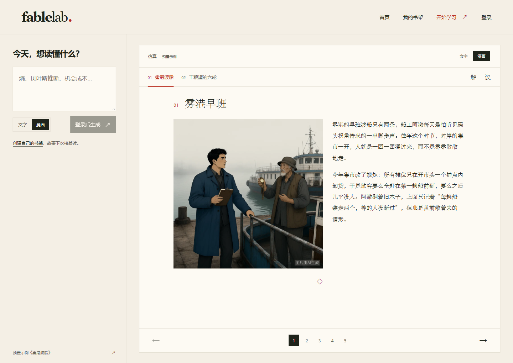
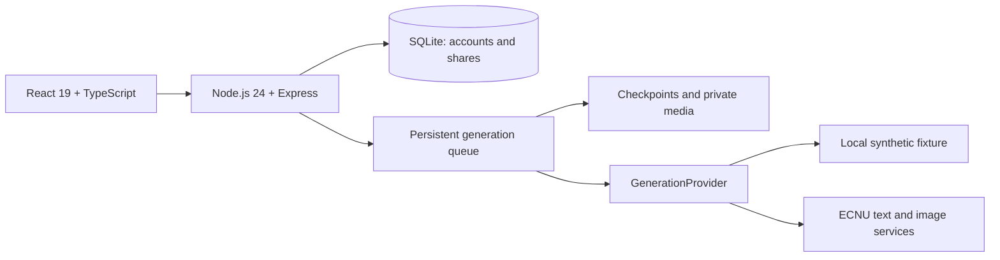

<div align="center">

# FableLab

**Read the story. Unpack the concept.**

A self-hostable, Chinese-first learning app that turns a difficult concept into a fable, then connects the story back to the underlying ideas.

[](https://github.com/bigWhiteTofu/FableLab/actions/workflows/ci.yml)
[](LICENSE)
[](https://nodejs.org/)

[Try the public example](https://yuyan.aiecnu.site/learn?demo=1&mode=comic) · [中文](README.zh-CN.md) · [Quick start](#quick-start-no-api-key) · [MIT](LICENSE)

</div>



<sub>Actual public preset, with AI-assisted artwork. The pictured preset retains two stories; newly generated lessons use one. The local mock generator uses fixed text and placeholder images.</sub>

## A story, then a closer look

| Read · 读 | Unpack · 解 | Discuss · 议 |
| --- | --- | --- |
| Follow a coherent fable, in text or illustrated pages. Both modes share the same story. | Reveal the formal concept, connect quoted story passages to its relations, and examine where the analogy stops working. | Try practice questions and explore guided discussion prompts. |

FableLab also includes a private bookshelf, account recovery codes, and read-only snapshot links you can revoke. Generation checkpoints persist across refreshes and server restarts; bounded retries continue unfinished stages and missing illustrations.

This is a learning app prototype. Its educational effects have not been formally evaluated. Generated references remain marked unverified, and machine review does not replace subject-matter review.

## Quick start: no API key

Requires **Node.js 24+**, npm, and Git. Allow about five minutes, depending on installation speed.

```sh
git clone https://github.com/bigWhiteTofu/FableLab.git
cd FableLab
npm ci
npm run build
```

Start the local mock in **PowerShell**:

```powershell
$env:NODE_ENV = 'development'
$env:STUDIO_HOST = '127.0.0.1'
$env:STUDIO_DATA_DIR = './data-demo'
$env:STUDIO_SYNTHETIC = '1'
$env:STUDIO_ENABLE_AI = '0'
npm run local
```

Or on **macOS / Linux**:

```sh
NODE_ENV=development STUDIO_HOST=127.0.0.1 STUDIO_DATA_DIR=./data-demo STUDIO_SYNTHETIC=1 STUDIO_ENABLE_AI=0 npm run local
```

Open [localhost:4318/in](http://127.0.0.1:4318/in). Read the built-in example, or register with the local development invitation code **`1025`** and generate a mock lesson. Passwords require at least six characters; keep the recovery code shown at registration. There is no email recovery.

Mock generation makes no model calls. It checks the workflow with fixed content and tiny placeholder images; it does not demonstrate live model quality. This demo's accounts and lessons are stored in `data-demo/`. Stop with **Ctrl+C**. See the [full local guide](docs/QUICKSTART.md) for configuration and development.

## Bring a model service

The current live adapter targets **ECNU's text and image services**. You need your own eligible account and server-side credentials. Enable `STUDIO_ENABLE_AI=1`, supply `ECNU_API_KEY`, and turn off synthetic mode. Other services require a [`GenerationProvider`](server/generation.ts) implementation; changing a base URL alone is insufficient. Read the [model service guide](docs/MODEL_SERVICE.md).

Generation runs **one job at a time**. Pausing stops local waiting but cannot guarantee that an upstream request has stopped or avoided charges. Production requires independent secrets, an invitation-code hash, and an HTTPS origin; synthetic mode is disabled there. Follow the [deployment guide](docs/DEPLOYMENT.md) before hosting.

## How it fits together



Vite builds the interface. Credentials stay on the server; lessons are private until their owner publishes a snapshot. Revocation blocks new access to that snapshot and its images; downloaded copies cannot be recalled.

## Inspiration

Inspired by [Anthropic's Amanda Askell sharing her parable prompt in an April 2026 Newcomer interview, at 53:42](https://www.youtube.com/watch?v=0GaKJ4Fp2x4&t=3222s): use a parable to approach an unfamiliar concept indirectly, then explain the concept afterward. FableLab adds an illustrated reader, explicit mappings, practice, persistence, and sharing around that idea. This independent project has no affiliation with or endorsement from Amanda Askell or Anthropic. See [source notes](SOURCES.md).

## Contribute

[Issues](https://github.com/bigWhiteTofu/FableLab/issues) and pull requests are welcome—especially concept corrections with evidence, accessibility improvements, and provider adapters. Use synthetic fixtures for tests and remove private data and credentials from examples.

Run `npm test` and `npm run build` before submitting code changes.

If story-first learning is useful to you, a star helps others discover FableLab.

## License

[MIT](LICENSE) · Copyright © 2026 bigWhiteTofu. See [asset provenance](docs/ASSETS.md) for the bundled demo illustrations.
