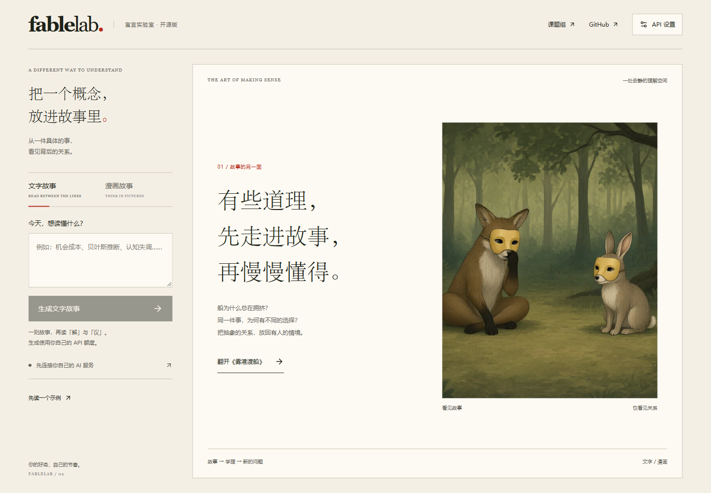

<div align="center">

# FableLab

**Read the story. Unpack the concept.**

Turn an abstract concept into a Chinese story or illustrated story, using your own AI services.

[](https://github.com/777spider/FableLab/actions/workflows/ci.yml)
[](LICENSE)
[](https://nodejs.org/)

[Research group ↗](https://aiecnu.site) · [简体中文](README.zh-CN.md) · [Quick start](#quick-start) · [API guide](docs/MODEL_SERVICE.md)

</div>



## Two ways to create

- **Text story:** enter a concept, read one fable, then explore the explanation (解) and questions (议).
- **Comic story:** the same learning flow, with 4–6 AI illustrations. Text and image services can be different.

The public edition runs on your computer. **No login, invitation code, bookshelf, or public sharing. No API key or paid quota is supplied by the author.** A built-in reading example works without a key. Generated stories use your own service and quota; the app is not a bundled local AI model.

## Quick start

Install [Node.js 24+](https://nodejs.org/), then run:

```sh
git clone https://github.com/777spider/FableLab.git
cd FableLab
npm ci
npm run local
```

Open **http://127.0.0.1:4318/learn/**. The local launcher checks and builds the current source before starting.

1. Open **API 设置** in the top right.
2. **Choose a text service, enter your key, and select a model.** The address and protocol fill automatically. A compatible local service may not need a key.
3. For comics, keep **文字与生图，共用一个 API** checked to share one service and key, with separate text/image models. Uncheck it to choose an independent image service. Read available models or enter their IDs manually.
4. Save, enter a concept, and generate a text or comic story.

A provider's monthly chat subscription does not necessarily include API access. Obtain API credentials and model access from your chosen service. No author or institutional service is required.

For a first look without credentials, select **先读一个示例**. This opens curated content and does not call a model.

## Bring your own API

**37 service and region presets** cover major Chinese and international providers, including DeepSeek, Alibaba, SiliconFlow, Volcengine, GLM, Kimi, MiniMax, Tencent TokenHub, Baidu, StepFun, OpenAI, Claude, Gemini, OpenRouter, xAI, Mistral, Groq, Together, Fireworks, DeepInfra, Cerebras, Perplexity, Hugging Face, Azure OpenAI, Stability AI, fal.ai, Replicate, Ollama, LM Studio and custom gateways. Each selector only offers its implemented modality. Preset selection fills addresses and protocols; recognized pasted roots or generation endpoints are normalized too. Azure requires your own resource address.

| Purpose | Supported protocol | Examples of compatible services |
| --- | --- | --- |
| Text | OpenAI Chat Completions | OpenAI, compatible gateways, DeepSeek/Qwen text services, Ollama or LM Studio with compatible endpoints |
| Text | OpenAI Responses | OpenAI or a service implementing Responses |
| Text | Anthropic Messages | Anthropic or a compatible Messages endpoint |
| Text | Google Gemini | Gemini generateContent |
| Text | OpenRouter | OpenRouter chat API |
| Images | OpenAI Images | Services implementing `/images/generations` |
| Images | Google Gemini | Gemini models with image output |
| Images | OpenRouter Images | OpenRouter's dedicated Images API |
| Images | Vendor-specific formats | SiliconFlow, MiniMax, GLM/CogView, Volcengine Seedream, Stability AI |
| Images | Official SDK adapters | fal.ai, Replicate |

Adapters use the open-source [Vercel AI SDK](https://github.com/vercel/ai), [official OpenRouter provider](https://github.com/OpenRouterTeam/ai-sdk-provider), and small adapters for vendor-specific image responses. Sharing is explicit and restricted to the same service address; switching endpoints clears the old key. Preset counts are not counts of paid vendor tests. Model availability depends on your account. See [the API guide](docs/MODEL_SERVICE.md) for the complete list and limits.

**Image input is not image output.** Explicit output-modality metadata is shown as declared support. A list containing only model names remains **unverified**. The optional **验证生图（1张）** button confirms actual image output for the selected configuration. It sends one real request and may incur a charge; it never runs automatically. Text testing may also incur a charge. Auth, quota, or network failures are not treated as proof that a model lacks image output.

## Reading and data

The reader keeps its page selector, arrows, 解 and 议 visible while content scrolls inside. Keyboard arrows work outside form fields and dialogs. Text uses complete device fonts, without downloading Chinese font slices.

- Keys stay in the local server's memory for the browser session. They are not written to localStorage, job files, exports, or application logs. Changing the endpoint does not inherit its old key.
- Requests travel from your local server to the service you configure. Your prompts and content are subject to that service's policies.
- Refreshing the same browser can reconnect while the local service runs. Generation continues when the page is closed, provided the local service remains running.
- Working story checkpoints and images live in an application-owned temporary directory; graceful shutdown removes them. A forced crash can leave temporary content behind, but no saved API keys. Restarting the service clears keys and does not restore earlier tasks. **Export text before stopping.** This edition has no persistent library.
- SDK retries are disabled. Application retries are bounded: at most two calls per stage and 24 attempts per task, including images. The app may need additional text calls for validation or repair; a comic uses one image request per page, plus bounded retries.

Machine review and model-provided references are not independent academic verification. Educational effects have not been established in a controlled study. [Source and inspiration notes](SOURCES.md) distinguish design inspiration from evidence.

## Development

```sh
npm test
npm run build
npm start
```

`npm start` serves the existing build. For live development, run `npm run dev` and `npx vite` in separate terminals. The default server binds to loopback only. See [local setup](docs/QUICKSTART.md), [operation boundaries](docs/DEPLOYMENT.md), and [validation](docs/VALIDATION.md).

The previous full Studio edition is preserved at tag **`full-studio-20261029`**. Some historical modules and their regression tests remain in this checkout, but the default entry point mounts only the BYOK app and never creates account databases. Earlier account, bookshelf, deployment and sharing guides apply only to that archived edition.

## License

Application code: [MIT](LICENSE). Third-party SDKs and bundled assets retain their own licenses; see [SOURCES.md](SOURCES.md), [font licenses](docs/FONTS.md), and [art inventory](docs/ASSETS.md).

Research group: **[aiecnu.site](https://aiecnu.site)**.
