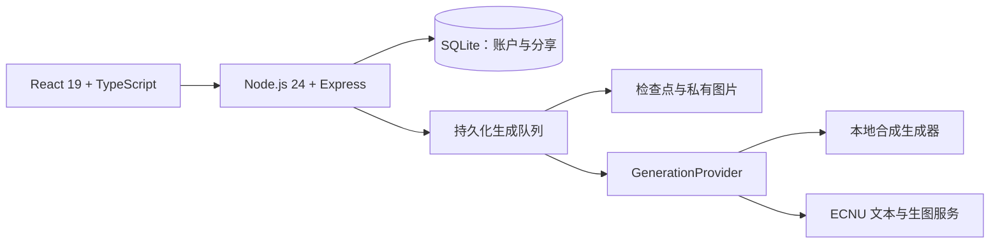

<div align="center">

# FableLab

**把陌生概念读成一个故事，再回到概念本身。**

一个可自部署的中文学习应用：先读寓言，再理解故事如何对应概念、又在哪里不再适用。

[](https://github.com/777spider/FableLab/actions/workflows/ci.yml)
[](LICENSE)
[](https://nodejs.org/)

[体验公开示例](https://yuyan.aiecnu.site/learn?demo=1&mode=comic) · [English](README.md) · [本地运行](#五分钟本地体验无需-api-key) · [MIT](LICENSE)

</div>


<sub>真实公开预置页面，插图由本项目借助 AI 生成。图中预置案例保留两则故事，新生成任务使用一则故事。本地合成生成器使用固定文字与占位图。</sub>

## 读—解—议

| 读 | 解 | 议 |
| --- | --- | --- |
| 逐页阅读一则连贯寓言；文字与漫画复用同一故事。 | 揭示正式概念，引用故事原文解释关系映射，并说明类比的适用边界。 | 完成练习题，沿着开放讨论提示继续思考。 |

账户保存私人书架；恢复码用于找回账户。可以主动发布只读快照，随时撤销分享。关闭浏览器或退出登录后，生成任务仍在服务端继续；返回账户可恢复原任务。临时故障的退避时间与检查点持久保存，服务重启后继续遵守，保留明确暂停、次数上限和原内容校验。详见[恢复机制与重试边界](docs/RECOVERY.md)。

文字生成可选**标准**或**长篇**。长篇通过更多行动、冲突与后果展开一则故事，由模型根据情节需要选择 **8–16 个自然场景／阅读页**；只提供文字，不发起生图请求。标准文字、漫画与两个预置案例继续保留，详见[写作设计](docs/WRITING_DESIGN.md)。

每个书架都放有两个可直接阅读的案例：《雾港渡船》（仿真，漫画）和《最后一张纸条》（教育 AI 可解释性，文字）。新书按创建时间排在前面；文字封面预览故事开头，书名留在书下，漫画保留原插图。点击书本会短暂提起，翻开后衔接到正文；选择减少动态效果时直接进入阅读。日期以小字置于封面左下。正文与控件使用完整本机中文无衬线字体，标题使用衬线字体，不下载字体分片；历史开源字体及许可保留，见[字体说明](docs/FONTS.md)。

2026-10-28源码更新尚未部署到公开体验站：独立服务的部署前SSH检查未通过，已在暂存、切换之前停止。

文字封面新增四组低饱和纸色与三种原创几何版画，以疏朗的中文衬线排版展示故事开头；书名只留在书下。配色、构图随书固定，刷新或排序不变。实图、GitHub参考和技能筛选见[书封设计](docs/COVER_DESIGN.md)。

当前定位为学习应用原型，尚无正式教学效果数据。生成来源保留待核验标记，机器初检不能代替学科专家审核。

[验收记录](docs/VALIDATION.md)：本地测试、构建和合成流程已通过；GitHub 自动检查也已完成依赖安装、测试和生产构建，全部通过。

## 五分钟本地体验：无需 API Key

需要 **Node.js 24+**、npm 和 Git；实际耗时取决于下载与安装速度。

```sh
git clone https://github.com/777spider/FableLab.git
cd FableLab
npm ci
npm run build
```

**PowerShell** 启动合成模式：

```powershell
$env:NODE_ENV = 'development'
$env:STUDIO_HOST = '127.0.0.1'
$env:STUDIO_DATA_DIR = './data-demo'
$env:STUDIO_SYNTHETIC = '1'
$env:STUDIO_ENABLE_AI = '0'
npm run local
```

**macOS / Linux**：

```sh
NODE_ENV=development STUDIO_HOST=127.0.0.1 STUDIO_DATA_DIR=./data-demo STUDIO_SYNTHETIC=1 STUDIO_ENABLE_AI=0 npm run local
```

打开 [localhost:4318/in](http://127.0.0.1:4318/in)，阅读预置示例，或用本地开发邀请码 **`1025`** 注册并生成合成任务。密码至少六字符；请保存注册时显示的恢复码，当前没有邮箱找回。

合成生成不调用模型，只用固定资料和极小占位图检查完整流程，不能代表真实生成质量。本演示的账户与学习资料保存在本地 `data-demo/`。按 **Ctrl+C** 停止服务。更多配置与开发步骤见[本地指南](docs/QUICKSTART.md)。

## 接入真实模型

当前适配器面向 **ECNU 文本与生图服务**，需要自行取得服务资格，并在服务端保存密钥。开启 `STUDIO_ENABLE_AI=1`、设置 `ECNU_API_KEY`，同时关闭合成模式。接入其他供应商需要实现 [`GenerationProvider`](server/generation.ts)，仅修改基础 URL 不足以保证兼容。详见[模型服务说明](docs/MODEL_SERVICE.md)。

生成队列全局并发为 **1**。暂停会中止本地等待，但不能保证上游已停止计算或免计费。生产环境需要独立密钥、邀请码哈希与 HTTPS 站点来源，并禁止合成模式；部署前请阅读[部署指南](docs/DEPLOYMENT.md)。

## 架构



Vite 构建前端，密钥留在服务端。学习资料默认私有，由所有者主动发布快照。撤销后，快照与图片不再允许新访问；他人已经下载的副本无法召回。

## 灵感来源

灵感来自 [Anthropic 的 Amanda Askell 于 2026 年 4 月接受 Newcomer 访谈的 53:42 段落](https://www.youtube.com/watch?v=0GaKJ4Fp2x4&t=3222s)：先用寓言间接呈现一个陌生概念，再在故事后解释概念。FableLab 围绕这一想法实现了漫画阅读、显式映射、练习、保存与分享。本项目独立开发，与 Amanda Askell 或 Anthropic 没有隶属或背书关系。核验记录见[来源说明](SOURCES.md)。

## 参与贡献

欢迎提交 [Issue](https://github.com/777spider/FableLab/issues) 或 Pull Request，尤其欢迎附有证据的概念纠错、无障碍改进与模型适配器。测试请使用合成资料，示例中移除私人数据与凭据。

代码修改提交前运行 `npm test` 与 `npm run build`。

如果你也喜欢用故事理解概念，欢迎点一个 Star，让更多人发现 FableLab。

## 许可证

[MIT](LICENSE) · Copyright © 2026 bigWhiteTofu。演示插图来源及字体的独立许可见[素材清单](docs/ASSETS.md)。
