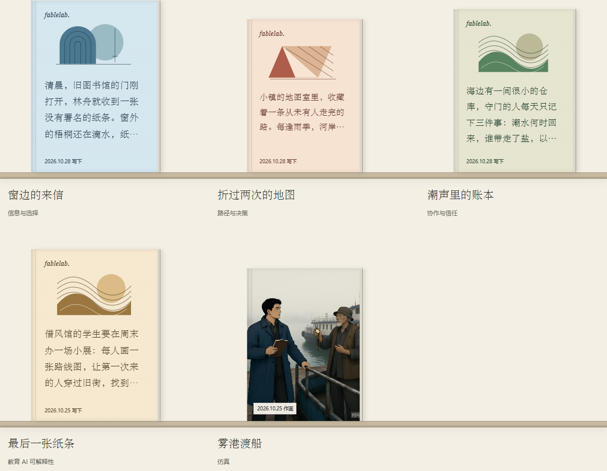

# 开篇书封 · Cover design

2026-10-28。文字封面展示故事的开头，书名只出现在书下。以现代文库书系为方向：暖纸、双色版画、疏朗的中文衬线文字；保留实体书口、压痕、层板和日期。

此图来自实际本地构建。前三本为明确的合成排版样例，末两本是应用自带案例；不是生产用户的书架，也未调用模型。

## GitHub research

| Reference | What informed the design | Reuse boundary |
| --- | --- | --- |
| [Variable Studio · Generative Covers](https://github.com/variablestudio/var-17006-generative-covers) | 实际查看其 covers.png；独立的几何构图与安静的文字区形成统一书系。 | 只参考构图。package 声明 MIT，但未见根 LICENSE；没有复制代码或图片。 |
| [sivan/heti](https://github.com/sivan/heti) | 中文段落的行距、字距、标点与阅读节奏。 | 已查看 MIT LICENSE；未导入其样式包或脚本。 |
| [anqxyr/racovimge](https://github.com/anqxyr/racovimge) | 受约束的模板与色板，让多本书既统一又有差异。 | MIT 代码之外的装饰、字体有各自来源；均未复制。 |
| [acestronautical/bookcover-js](https://github.com/acestronautical/bookcover-js) | 少量几何元素、稳定留白与双色印刷关系。 | MPL-2.0；未复制代码、品牌版式或素材。 |
| [Leonxlnx/taste-skill](https://github.com/Leonxlnx/taste-skill) | 清楚的美术方向，以及实现后回到浏览器检查。 | 设计方法参考，没有执行仓库代码或添加依赖。 |

本地技能库采用 **impeccable** 的产品界面、排版与色彩规则，以及 **redesign-existing-projects** 的现有项目局部改版流程。也比较了 gpt-taste、design-taste-frontend、high-end-visual-design、minimalist-ui；没有采用不适合阅读书架的营销页结构、玻璃效果或滚动动画。

## Implementation

- 四组低饱和纸色：鼠尾草绿、陶土、麦色、灰蓝；三种原创 SVG 版画：拱线、折页、潮线。装饰为抽象构图，不冒充生成故事的情节插画。
- 根据书的 ID 确定色板和构图。刷新、任务恢复与排序变化均不重新随机。
- 开篇来自保存的故事段落，保留原文；React 作为文本渲染。可用高度决定显示行数，溢出显示省略号，移动端不低于 14px。书名保留在书下，日期保留左下。
- 本机中文衬线字体用于书封和书名；阅读正文与控件继续使用完整本机无衬线字体。没有新增字体下载、图片请求、第三方运行代码或依赖。
- 保留漫画原有封面、按创建时间排序、整书链接、翻开过渡、返回焦点和减少动态效果设置。320px 导航改为两行，避免汉字标签拆行；辅助跳转链接只在键盘聚焦时显示。

## Checks and delivery boundary

Studio 的 84 项既有测试、构建通过。实际浏览器检查 27 项通过；查看了桌面 1440px、平板 768px、手机 390px 与 320px 截图，以及局部书封。四种文字/纸色对比度为 9.41–10.21:1；开篇不溢出、不遮日期，没有重复标题。漫画插图、翻开、返回焦点与减少动态效果均通过。私人故事使用隔离浏览器的只读模拟数据，不构成生产账户验收。

公开仓库的 86 项测试与构建通过，四份相关界面源码与本地 Studio 相同。本次艺术改版尚未部署到公开体验站；公开源码和本地预览不代表公网已更新。
